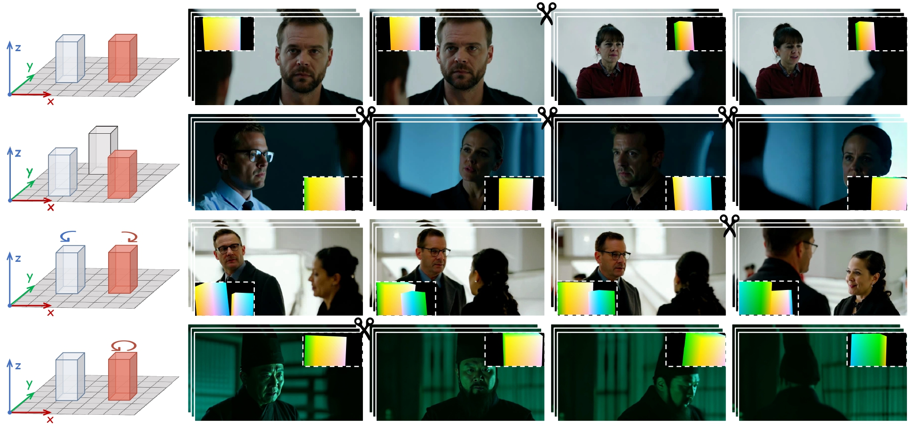
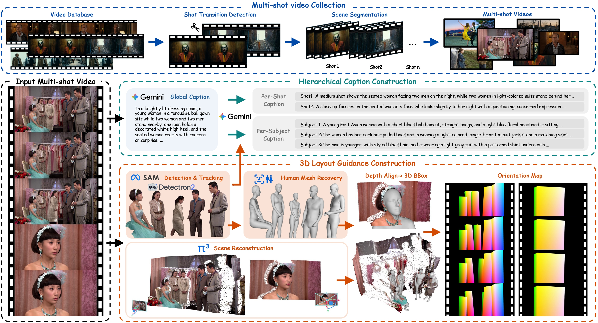

<h1 align="center">
  Mise-en-Video:<br>
  Fine-Grained 3D Control for Multi-Shot Video Generation
</h1>

<p align="center">
  <b>Yingshuang Zou</b><sup>1,*</sup> &ensp;
  <b>Xiaoyu Shi</b><sup>2,†</sup> &ensp;
  <b>Yawen Luo</b><sup>3</sup> &ensp;
  <b>Ziang Li</b><sup>4</sup> &ensp;
  <b>Qinghe Wang</b><sup>5</sup> &ensp;
  <b>Mengfei Li</b><sup>1</sup><br>
  <b>Chengfeng Zhao</b><sup>1</sup> &ensp;
  <b>Xintao Wang</b><sup>2</sup> &ensp;
  <b>Pengfei Wan</b><sup>2</sup> &ensp;
  <b>Kun Gai</b><sup>2</sup> &ensp;
  <b>Yuan Liu</b><sup>1,†</sup>
</p>

<p align="center">
  <sup>1</sup>The Hong Kong University of Science and Technology
  &ensp;·&ensp;
  <sup>2</sup>Kuaishou Technology<br>
  <sup>3</sup>The Chinese University of Hong Kong<br>
  <sup>4</sup>Northwestern Polytechnical University
  &ensp;·&ensp;
  <sup>5</sup>Dalian University of Technology
</p>

<p align="center">
  <sup>*</sup>Work done during an internship at KwaiVGI, Kuaishou Technology.<br>
  <sup>†</sup>Corresponding authors.
</p>

<p align="center">
  <a href="https://heiheishuang.xyz/Mise-en-Video/">Project Homepage</a>
</p>

<p align="center">
  
</p>

> **Figure 1.** We propose MeV to help creators generate high-quality multi-shot
> video content. For each shot, creators specify a 3D layout, akin to staging a
> real 3D set (first column), and define actors' appearance, trajectories,
> positions, and other 3D scene parameters. We render the 3D layout as a control
> signal (shown in the insets) and feed it into the generator, enabling stronger
> cross-shot consistency and finer-grained controllability.

## Overview

**Mise-en-Video (MeV)** is a fine-grained, 3D-controllable framework for
multi-shot video generation. It combines hierarchical attention for narrative
consistency with 3D-aware layout guidance for precise per-shot spatial control.

This repository releases the **data processing and annotation framework** used by
MeV. Given a complete video and its shot clips, the pipeline:

1. reconstructs scene geometry and cameras with Pi3;
2. detects, segments, and tracks people with ViTDet and SAM2;
3. estimates per-frame SMPL humans with CameraHMR;
4. matches subject identities across shots;
5. aligns humans with scene geometry and produces temporally smoothed 3D OABBs;
6. renders NOCS layout-control videos for downstream MeV training and evaluation;
7. optionally generates global, shot-level, and subject-level captions.

<p align="center">
  
</p>

> **Figure 2.** Multi-shot data annotation pipeline. We first collect videos
> from the Internet and segment them into shots to form multi-shot samples. We
> then construct 3D layouts through subject detection and tracking, human mesh
> recovery, scene reconstruction, depth alignment, and NOCS encoding. Finally,
> we generate hierarchical global, shot-level, and subject-level captions with
> consistent subject identities across shots.

For NOCS condition rendering, see
[VIDEO_BBOX_PIPELINE.md](VIDEO_BBOX_PIPELINE.md) for detailed input/output
specifications and stage-level options.

## Installation

### 1. Clone this repository

```bash
git clone https://github.com/heiheishuang/Mise-en-Video.git Mise-en-Video
cd Mise-en-Video
```

### 2. Create the environment

Linux, Conda, and an NVIDIA CUDA GPU are required.

```bash
conda create -n mev python=3.10 -y
conda activate mev
./install.sh
```

### 3. Prepare third-party repositories

Third-party source code and model checkpoints are not committed to this
repository. Run the following commands from the repository root:

```bash
# Pi3: weights are downloaded from Hugging Face on first use.
git clone https://github.com/yyfz/Pi3.git 3rdparty/Pi3

# CameraHMR
git clone https://github.com/pixelite1201/CameraHMR.git 3rdparty/CameraHMR

# SAM2
git clone https://github.com/facebookresearch/sam2.git 3rdparty/SAM2
python -m pip install -e 3rdparty/SAM2

# SAM2 large checkpoint
mkdir -p 3rdparty/tracking_assets/sam2
wget -O 3rdparty/tracking_assets/sam2/sam2.1_hiera_large.pt \
  https://dl.fbaipublicfiles.com/segment_anything_2/092824/sam2.1_hiera_large.pt
```

Download the CameraHMR, ViTDet, and SMPL assets by following CameraHMR's
[Download Required Files](https://github.com/pixelite1201/CameraHMR#download-required-files)
instructions. The MeV-specific tracking-aware batch adapter lives in
`tools/camerahmr_batch.py`; the upstream CameraHMR checkout does not need to be
modified.

Tested third-party revisions are recorded in
[`3rdparty/LOCK.json`](3rdparty/LOCK.json).

## Input

The input directory contains one complete video and shot clips numbered
contiguously from zero:

```text
example/video/
├── example.mp4
├── example-shot0.mp4
└── example-shot1.mp4
```

Use `--video-dir` and `--results-dir` to process another dataset.

## Running the pipeline

Cross-shot identity matching uses the Google Gemini API. Set the key outside the
repository, then run the complete data-processing pipeline:

```bash
conda activate mev
export GEMINI_API_KEY='YOUR_KEY'
./tools/run_pipeline.py
```

The pipeline order is:

```text
depth → tracking → camerahmr → match → bbox
```

Useful partial runs:

```bash
./tools/run_pipeline.py --from-stage match --to-stage bbox
./tools/run_bbox_video.py --render-only
./tools/run_camerahmr.py --overwrite
```

To run without Gemini, stop after CameraHMR and invoke bbox directly. Subjects
without an existing cross-shot mapping will receive fallback IDs.

```bash
./tools/run_pipeline.py --to-stage camerahmr
./tools/run_bbox_video.py
```

Optional caption generation runs separately and does not modify
`matched_id.json`:

```bash
export GEMINI_API_KEY='YOUR_KEY'
./tools/run_gemini_captions.py --stage caption
```

Outputs are written to `example/results/` by default. Existing complete
intermediate artifacts are reused; `--overwrite` reruns depth, tracking, and
CameraHMR.

## Citation

If you find this work or the data-processing pipeline useful, please cite:
TODO

## Acknowledgements

This data-processing framework is built with help from the following excellent
open-source projects:

- [Pi3](https://github.com/yyfz/Pi3) for scene geometry and camera reconstruction;
- [CameraHMR](https://github.com/pixelite1201/CameraHMR) for camera-aware human
  mesh recovery;
- [SAM 2](https://github.com/facebookresearch/sam2) for video mask propagation;
- [Detectron2](https://github.com/facebookresearch/detectron2) and ViTDet for
  person detection;
- [PyTorch3D](https://github.com/facebookresearch/pytorch3d) for differentiable
  3D geometry and rendering utilities.

We thank the authors and contributors of these projects. Please follow their
respective licenses and model-usage terms. The optional text and identity stages
use the Google Gemini API.
